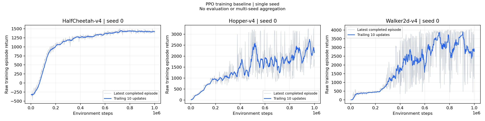
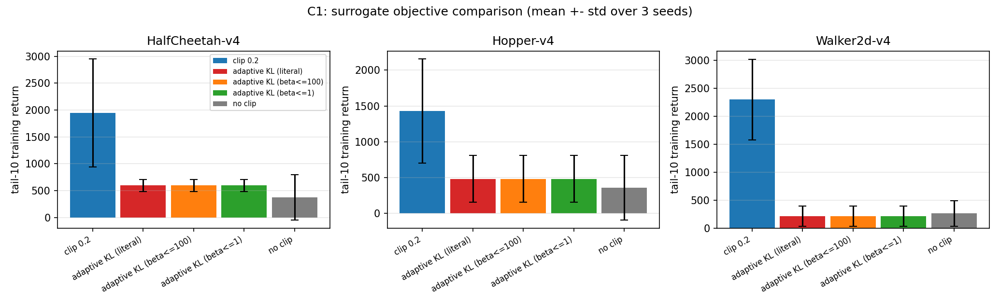
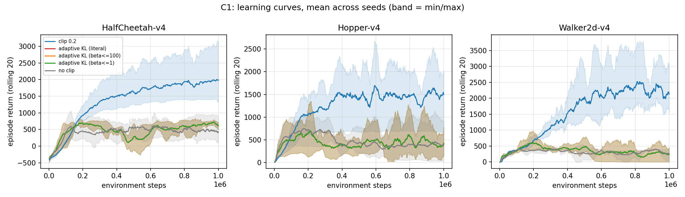
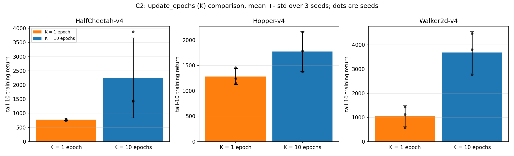
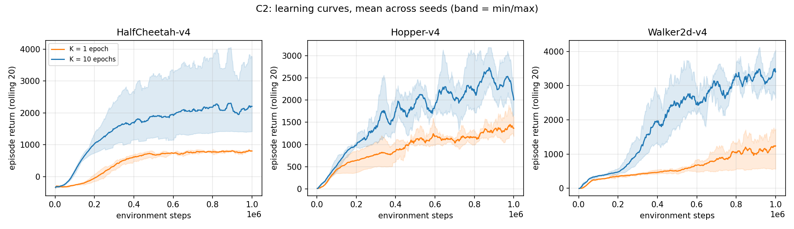

# Reproducing PPO's surrogate-objective claim on MuJoCo

**Draft status: W4 (2026-11-27).** Sections 1–3 are written from the measured
evidence; sections 4–7 are drafts with the C1 verdicts in place and the C2
analysis to be completed in W6. Every number marked "measured" is generated by
the scripts in §6 from `runs/*/progress.csv`; no number is typed by hand.

Authors: MIAE01 project team (names and student IDs to be added in the W7 final
version — this draft does not invent them).

## Abstract

We reproduce the central empirical claim of Proximal Policy Optimization (PPO,
arXiv:1707.06347v2): among the three surrogate objectives compared in the paper's
Table 1 — the clipped objective (ε = 0.2), an adaptive KL penalty (d_targ = 0.01)
and no clipping at all — the clipped objective performs best and the unclipped one
worst. On three MuJoCo tasks with three seeds each we find the two ends of that
ordering supported and the middle entry **inconclusive**: our re-implementation of
the adaptive KL penalty degenerates into "minimise KL only", so it cannot settle
the paper's claim about that tier. We additionally run a single-factor experiment
(C2) on the number of optimization epochs per rollout, K ∈ {1, 10}, which the
paper never ablates: K = 10 wins in all three tasks and in all nine same-seed
pairs, by +38% to +250%, at about 1.4× the wall-clock cost. The diagnostics show
why: with K = 1 the clipping band is essentially never entered (`clipfrac` = 0.000
on every seed), so the default K = 10 is what gives the clipped surrogate something
to clip. All scores are raw training returns, not evaluation scores; we compare
orderings, never absolute values against the paper.

## 1 Introduction

PPO's contribution is a family of surrogate objectives that keeps policy updates
inside a trust region without solving a constrained optimization problem. The
paper's headline empirical claim is not a single number but a **ranking** of three
of those objectives on seven MuJoCo tasks (Table 1): clipping at ε = 0.2 gives an
average normalised score of 0.82, an adaptive KL penalty with d_targ = 0.01 gives
0.74, and dropping the mechanism entirely gives −0.39. A replication that lands on
different absolute numbers but preserves that ranking supports the claim; one that
reverses it falsifies it.

Our project asks three questions, one per week of experiments:

* **C1** (W3): does the ordering clip > adaptive KL > no clip hold in our
  measurements?
* **C2** (W4): what does reusing the same rollout for several optimization epochs
  (K) actually buy? The paper fixes K = 10 and never ablates it.
* **C3** (W5): is K a knob worth tuning — that is, does the paper's default K = 10
  sit at a good point of a K sweep?

We deliberately reduce scale: 3 of the paper's 7 tasks, 3 seeds per setting, and no
evaluation-episode protocol (our metric is the training return, see §2.5). This is
declared throughout and recorded in the deviation log (§2.6).

## 2 Reproduction setup

### 2.1 What is reproduced, and what would count as a reproduction

| Paper claim | Where | Our measurement | Falsified if |
|---|---|---|---|
| Clipping (ε = 0.2) beats no clipping | Table 1 | tail-10 training return, 3 tasks × 3 seeds | the ordering flips in a majority of tasks, beyond seed noise |
| Clipping beats adaptive KL (d_targ = 0.01) | Table 1 | same | same |
| Adaptive KL beats no clipping | Table 1 | same | same |
| K = 10 is a good default (never ablated) | Table 3 | C2: K ∈ {1, 10}, one factor | K = 1 is better, or the difference is inside noise |
| The clipped surrogate is a usable mechanism at all | §3, Eq. 7 | absolute training returns and learning curves | the agent fails to learn on our tasks |

The paper's absolute scores are normalised per task with a random-policy zero point
and an unpublished best-result scale, over 7 tasks. Ours are raw returns on 3
tasks, so §2.5 and `docs/paper_vs_ours.md` compare **orderings**, never magnitudes.

### 2.2 Code base, upstream and pinned versions

The trainer is the single-file CleanRL PPO implementation
(`cleanrl/ppo_continuous_action.py`, upstream commit `cf20043`, MIT licence)
vendored into `src/ppo_continuous_action.py` with the logging additions listed in
`MODIFICATIONS.md`. The seven-check W2 audit in `scripts/audit_upstream.py` checks
the loss/optimizer body, GAE recurrence, wrapper chain and default network
initialisation against that commit.

Frozen environment (CPU only, one OMP/MKL thread per process):

| Component | Version |
|---|---|
| Python | 3.10.22 (W2/W4), 3.10.21 (W3) |
| PyTorch | 2.4.1 (CPU wheel in W2/W3; CUDA build used on CPU in W4) |
| Gymnasium | 0.29.1 |
| MuJoCo | 3.1.6 |
| NumPy | 1.26.4 |

`requirements-lock.txt` is the full freeze, `env.txt` the generated machine
snapshot. Every run's `config.json` records the git commit, the dirty flag, the
SHA-256 of the executed training sources and the installed package versions, so a
run is self-describing even after the repository moves on.

### 2.3 Environments, seeds and budget

Three of the paper's seven `-v1` tasks, on modern `-v4` environments:
HalfCheetah-v4, Hopper-v4, Walker2d-v4. Seeds 0/1/2. Each run consumes exactly
1,000,000 environment steps: 488 full 2,048-step rollouts plus one 576-step final
rollout, 489 updates, with the learning rate annealed over all 489 updates. This
exact-budget loop is an explicit departure from the vendored floor-budget loop and
is recorded in the deviation log.

Smoke runs (20,000 steps) exist to prove the pipeline but are excluded from every
result table; failed runs stay in the run index with status `failed`.

### 2.4 Data and initial weights

The paper's MuJoCo experiments use no dataset, no train/validation split and no
pre-trained weights, and neither does this reproduction. The three tasks are
procedural simulators shipped as Python packages (`gymnasium==0.29.1`,
`mujoco==3.1.6`, pinned in `requirements-lock.txt`); installing the lock file is
the only data-acquisition step, and after installation no network access is
needed. The policy and value networks are initialised randomly from the seed
(`--seed 0/1/2`, recorded in every `config.json`); the observation and reward
normalisation statistics are estimated online from each run's own rollouts and
are therefore part of the run, not an artefact of a shared pre-computed
statistics file. Nothing is downloaded at train time, so a run is described
completely by its command line, seed and source hashes.

### 2.5 Measurement definitions

* **Score of a run**: the mean raw training return over the last ten logged
  episodes; the trainer logs the most recent completed episode's return at each
  update (carried forward if no episode ended). This is a training-time quantity,
  not an evaluation protocol, and it is not comparable to the paper's "average
  total reward of the last 100 episodes".
* **Across seeds**: mean ± std over seeds 0/1/2 (sample standard deviation).
  The paper reports no variance, so our error bars are an addition.
* **Diagnostics**: `approx_kl` (the k3 estimator, final minibatch of the update),
  `clipfrac` (fraction of probability ratios outside the 0.2 band, averaged over
  minibatches), entropy and explained variance. Under the KL-penalty arm
  `clipfrac` is a diagnostic only, not a loss term.

### 2.6 Deviations

`docs/deviations.md` records every departure from the paper or from the previous
week's setting, in the required four columns (item, original setting, setting used,
reason/consequence); it now runs to 32 entries (13 from W2, 7 from W3, 12 from W4)
covering the environment version, wrapper and normalisation chain, value-loss
clipping, the exact-budget loop, thread and hardware choices, the adaptive-KL
implementation and its beta bound, the C2 machine and Python build, and the
normalisation used in the Paper-vs-Ours table.

## 3 Results

### 3.1 Baseline pipeline (W2)

Before any comparison, the pipeline was validated at full scale: three
environments, seed 0, `clip0.2`, exactly 1,000,000 steps each (Table 1, Figure 1).
These are single-seed runs that establish "the loop learns and the evidence is
traceable"; they are not C1 evidence.

**Table 1.** W2 baseline runs (seed 0, clip0.2, 1,000,000 steps, 489 updates).

| Task | Updates | Wall time (min) | Tail-10 training return |
|---|---:|---:|---:|
| HalfCheetah-v4 | 489 | 37.10 | 1421.16 |
| Hopper-v4 | 489 | 39.72 | 2159.50 |
| Walker2d-v4 | 489 | 40.13 | 2775.81 |



**Figure 1.** W2 baseline training curves. Thin line: most recent completed
episode; thick line: trailing 10-update mean. Single seed, raw training returns.

### 3.2 C1: the three surrogate objectives (W3)

The C1 matrix is 3 objectives × 3 tasks × 3 seeds = 27 runs of 1,000,000 steps,
plus 18 controlled runs in which the KL penalty's beta upper bound is changed
alone. Table 2 and Figures 2–3 summarise the result the paper's Table 1 is about.

**Table 2.** C1: tail-10 training return, mean ± std over seeds 0/1/2.

| Task | clip 0.2 | adaptive KL | no clip |
|---|---:|---:|---:|
| HalfCheetah-v4 | **1945.0 ± 1006.1** | 596.2 ± 109.8 | 375.0 ± 422.4 |
| Hopper-v4 | **1430.7 ± 726.3** | 479.6 ± 327.4 | 355.4 ± 451.0 |
| Walker2d-v4 | **2297.5 ± 718.5** | 209.8 ± 181.2 | 261.9 ± 227.0 |



**Figure 2.** C1 grouped bars: tail-10 training return per objective and task,
error bars = ± 1 std over three seeds.



**Figure 3.** C1 learning curves: rolling 20-update mean across seeds, band =
min/max across seeds.

Ordering checks computed from Table 2 (generated, not hand-written; see
`docs/paper_vs_ours.md` Table 3):

| Sub-claim | Holds in | Status |
|---|---|---|
| clip 0.2 > no clip | 3/3 tasks | consistent with the paper |
| clip 0.2 > adaptive KL | 3/3 tasks | consistent with the paper |
| adaptive KL > no clip | 2/3 tasks | partial (Walker2d reverses it) |

The three KL-penalty runs with beta bounded at `1e300`, `100` and `1` produce
**row-identical `progress.csv` files** except the wall-time column. A 150-order-of-
magnitude change in beta cannot leave the trajectory untouched by chance; §4.2
gives the mechanism. The consequence is that the middle tier of the paper's
ordering is **inconclusive** in our replication, and that verdict — not a
"contradiction" — is what §4.1 reports.

### 3.3 C2: what does repeating the batch for K epochs buy? (W4)

The paper fixes K = 10 in Table 3 and never ablates it. We hold everything else at
the paper default — clipped objective, ε = 0.2, 1,000,000 steps, seeds 0/1/2 — and
change K alone: 9 runs per arm, both arms launched by the same script on the same
host, so a host change cannot explain a difference. Table 4 and Figure 4 give the
result; Table 5 adds the diagnostics and the cost.

**Table 4.** C2: tail-10 training return, mean ± std over seeds 0/1/2; Δ = K10 − K1.

| Task | K = 1 | K = 10 | Δ | Ratio |
|---|---:|---:|---:|---:|
| HalfCheetah-v4 | 772.7 ± 32.2 | 2247.8 ± 1411.8 | +1475.2 | 2.91× |
| Hopper-v4 | 1282.8 ± 156.8 | 1775.4 ± 389.7 | +492.5 | 1.38× |
| Walker2d-v4 | 1046.2 ± 436.0 | 3688.0 ± 856.6 | +2641.8 | 3.53× |

Per-seed values (K = 1 → K = 10): HalfCheetah 793.8→1421.2, 735.7→1444.3,
788.5→3878.0; Hopper 1455.8→2159.5, 1242.8→1380.4, 1149.9→1786.2; Walker2d
575.9→2775.8, 1436.8→3813.1, 1126.0→4475.2. K = 10 wins in **3/3 tasks** and in
**9/9 same-seed pairs**.

**Table 5.** C2 diagnostics (mean over the last 50 updates) and cost (wall minutes
per run, 9 processes concurrently on one host).

| Task | clipfrac K=1 / K=10 | approx_kl K=1 / K=10 | entropy K=1 / K=10 | wall min K=1 / K=10 |
|---|---:|---:|---:|---:|
| HalfCheetah-v4 | 0.000 / 0.056 | 0.00007 / 0.00725 | 7.9 / 2.2 | 20.0 / 29.5 |
| Hopper-v4 | 0.000 / 0.030 | 0.00004 / 0.00477 | 3.9 / 1.8 | 22.0 / 30.9 |
| Walker2d-v4 | 0.000 / 0.046 | 0.00006 / 0.00679 | 7.9 / 3.2 | 21.8 / 28.3 |



**Figure 4.** C2 grouped bars: tail-10 training return per arm and task, error bars
± 1 std over three seeds, dots are the individual seeds.



**Figure 5.** C2 learning curves: rolling 20-update mean across seeds, band =
min/max across seeds. The gap opens after ~0.2M steps on all three tasks.

The mechanism is visible in Table 5. At K = 1 the policy moves very little per
update: `approx_kl` is 4–8 × 10⁻⁵ and `clipfrac` is **0.000 on every seed and every
task**, so the ε = 0.2 band is essentially never entered; entropy stays close to
its initial value on two of the three tasks. At K = 10 the same measurement rises
about 100× to 5–7 × 10⁻³ (still below the paper's d_targ = 0.01) and 3–6% of ratios
leave the band. In other words, the paper's default K = 10 is what gives the
clipping mechanism something to clip; with a single pass per rollout, the clipped
surrogate is close to an ordinary policy-gradient step. The cost is real: K = 10
takes about 1.39× the wall-clock time (21.3 → 29.5 minutes per run on average).

### 3.4 Extension (W5, planned)

The planned extension varies K alone over {1, 3, 10, 20} on the same three tasks and
seeds, reusing the C2 infrastructure (`--label k<K>`, `verify_runs.py --c2` style
matrix checks). [W5-TBD: results and one-sentence conclusion.]

## 4 Critical analysis

### 4.1 Verdict per claim

| Claim | Verdict | Evidence |
|---|---|---|
| Clipping beats no clipping | **supported** | 3/3 tasks; gaps far outside the seed spread (Table 2) |
| Clipping beats adaptive KL | **supported** | 3/3 tasks |
| Adaptive KL beats no clipping | **partially supported** | 2/3 tasks; Walker2d is inside one std and reverses |
| Adaptive KL is a usable surrogate objective | **inconclusive in this implementation** | degenerate trajectories (§4.2), not a property of the paper's algorithm |
| K = 10 is a sensible default | **supported** | K = 10 > K = 1 in 3/3 tasks and 9/9 same-seed pairs, +38%…+250% (§3.3) |

### 4.2 Why our adaptive-KL tier degenerates (analysis, not measurement)

*This paragraph is an inference from the measurements, and is labelled as such.*

When `beta * KL` dominates the policy term, the gradient of the total loss is
essentially the gradient of the KL penalty; `clip_grad_norm_(0.5)` then normalises
every step to length 0.5 along the KL-descent direction, independent of beta's
magnitude. The policy therefore stops improving the return and sits at a low-return
point, which is what Table 2 shows. This also explains the row-identical
trajectories across the three beta settings: beta's value stops mattering once it
is large enough for the penalty to dominate. It does **not** show that the paper's
adaptive KL objective is ineffective; it shows that our implementation inside this
CleanRL training loop, with this gradient-clipping constant, degenerates. Settling
the paper's middle tier would need either an implementation without global gradient
clipping or a schedule that keeps the penalty from dominating from the first update.

### 4.3 What C2 does and does not show

*It shows* that, with this trainer, this step budget and this clipping constant, a
single pass over each rollout leaves most of the learning unused: KL ≈ 7 × 10⁻⁵ per
update, `clipfrac` exactly 0.000, entropy barely below initialisation. That is a
statement about the surrogate *combined with* the optimiser, and it is the mechanism
behind the +38%…+250% return gain at K = 10. It also ties the two experiments
together: the trust-region mechanism the paper argues about only has an effect once
more than one epoch is run over a batch, so the paper's unremarked default K = 10 is
part of why its clipped objective performs well.

*It does not* isolate "more gradient steps" from "re-normalised advantages": with
per-minibatch normalisation, every extra epoch re-standardises the same samples, so
both effects are bundled into K. Separating them would need an arm that keeps the
first epoch's normalisation statistics for all epochs — a cheap W6 follow-up, not
run here.

*It does not* locate the optimum: K = 10 beating K = 1 says nothing about whether
K = 20 or K = 3 is better, which is exactly what the W5 extension sweeps.

*It is not* an efficiency win in wall-clock terms: K = 10 costs about 1.39× the time.
If the budget were wall-clock rather than environment steps, the comparison would
tighten, though not close (K = 1 spends 21 minutes to reach 773–1283).

### 4.4 Differences that could move the ordering

Every item in the deviation log is a candidate explanation for a mismatch, but four
dominate: (i) the wrapper chain normalises observations and rewards, while the
paper's 2017 setup did not use CleanRL's configuration exactly; (ii) `-v4`
environments and MuJoCo 3.1.6 differ from the paper's `-v1` / MuJoCo 1.x; (iii) the
paper's normalisation constants are unpublished, so any normalised comparison is
built on a different anchor; (iv) with three seeds, the seed spread is large
(HalfCheetah clip0.2 spans 1247–3098), so only orderings, not gaps, are defensible.

### 4.5 What would falsify our verdicts

* Re-run the KL arm with gradient clipping disabled, or with the beta adaptation
  driven by the KL measured before the update: if it then trains comparably to
  clipping, our "inconclusive" becomes "contradicted".
* Re-run C1 with evaluation rollouts (frozen policy, 10 episodes per checkpoint): if
  the ordering changes, our training-return metric was the problem, not the
  objectives.
* Add tasks beyond the three: a 3-task ordering is weaker evidence than the paper's
  7-task average, especially for the KL-vs-noclip pair.

## 5 Limitations

1. **Reduced scale**: 3 of 7 tasks, 3 seeds, one 1M-step budget per run. Declared,
   but it caps the strength of every ordering claim.
2. **No evaluation protocol**: scores are training returns sampled at update
   boundaries; they are optimistic and noisy relative to an evaluation average.
3. **Adaptive KL is ours, not the authors'**: the paper's implementation is not
   published, and our version degenerates (§4.2), so the middle tier is untested
   rather than refuted.
4. **Different machines per week**: W2, W3 and W4 ran on three different hosts
   with different Python patch versions and, in W4, a CUDA-built PyTorch used on
   CPU. C2's arms are same-host by construction; C1's are not re-run per host.
5. **No variance in the paper**: our ± std cannot be compared with a published
   interval because none exists.

## 6 Reproducibility

Every artifact under `figures/`, `logs/` and the generated docs is produced by a
script:

```powershell
$PpoPython = 'D:\miniconda3\envs\ppo-repro\python.exe'
& $PpoPython -m unittest discover -s tests -v          # 26 regression tests
& $PpoPython scripts/verify_runs.py --baseline         # W2 evidence
& $PpoPython scripts/verify_runs.py --c2               # W4 evidence
& $PpoPython scripts/make_all.py                       # summaries, figures, tables, checks
```

A fresh run set can be produced with `scripts/run_baseline.py` (W2),
`scripts/run.py --variant ... --label ...` (C1) and `scripts/run_c2.py` (C2). Run
directories are listed in `logs/runs.csv`; the accepted matrices are recorded in
`logs/w2_baseline.json` and `logs/w4_c2.json`; the machine-readable versions of the
tables are `logs/c1_summary.json`, `logs/c2_summary.json` and
`logs/paper_vs_ours.json`.

## 7 Contributions and AI usage

[W7-TBD: per-member contribution table, signed.]

*Text drafted with AI assistance; the boundary between generated text, generated
code and measured results is recorded in `AI_USAGE.md`. No result in this report
was produced by the assistant.*

## References

1. J. Schulman, F. Wolski, P. Dhariwal, A. Radford, A. Klimov. *Proximal Policy
   Optimization Algorithms.* arXiv:1707.06347v2, 2017.
2. CleanRL, `cleanrl/ppo_continuous_action.py` at commit `cf20043` (MIT licence).
3. Gymnasium 0.29.1 and MuJoCo 3.1.6 documentation.
4. Team reading notes on PPO, course workspace (`PPO_论文精读_arXiv1707.06347.md`).
