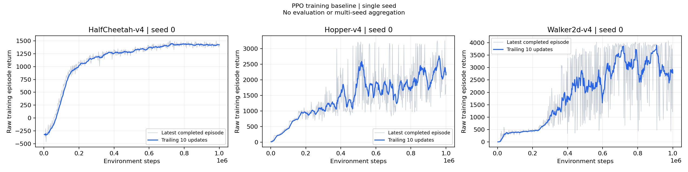

# W2 baseline evidence

Generated by `scripts/summarize_baseline.py` from verified CSV files; do not hand-edit numbers.

All three runs use seed 0, clip0.2, CPU, one thread, Gymnasium 0.29.1 and MuJoCo 3.1.6.
Each run has exactly 1,000,000 environment steps and 489 updates. Full configuration and logs are linked below.

| Environment | Steps | Updates | Wall time (min) | Last logged return | Last 10 updates mean |
|---|---:|---:|---:|---:|---:|
| HalfCheetah-v4 | 1,000,000 | 489 | 37.10 | 1440.25 | 1421.16 |
| Hopper-v4 | 1,000,000 | 489 | 39.72 | 1837.92 | 2159.50 |
| Walker2d-v4 | 1,000,000 | 489 | 40.13 | 2717.91 | 2775.81 |

Returns are raw **training** episode returns sampled at update boundaries. The last-ten-update mean is descriptive and may repeat an episode; it is neither an evaluation score nor a multi-seed estimate. W2 does not establish the C1 ranking.



## Raw evidence

- HalfCheetah-v4: [config](../runs/20261115-161151-400845_HalfCheetah-v4_seed0_clip0.2_full/config.json), [progress](../runs/20261115-161151-400845_HalfCheetah-v4_seed0_clip0.2_full/progress.csv), [stdout](../runs/20261115-161151-400845_HalfCheetah-v4_seed0_clip0.2_full/stdout.log).
- Hopper-v4: [config](../runs/20261115-161151-397383_Hopper-v4_seed0_clip0.2_full/config.json), [progress](../runs/20261115-161151-397383_Hopper-v4_seed0_clip0.2_full/progress.csv), [stdout](../runs/20261115-161151-397383_Hopper-v4_seed0_clip0.2_full/stdout.log).
- Walker2d-v4: [config](../runs/20261115-161151-401829_Walker2d-v4_seed0_clip0.2_full/config.json), [progress](../runs/20261115-161151-401829_Walker2d-v4_seed0_clip0.2_full/progress.csv), [stdout](../runs/20261115-161151-401829_Walker2d-v4_seed0_clip0.2_full/stdout.log).

- [Run index](../logs/runs.csv), [accepted matrix](../logs/w2_baseline.json), [machine-readable summary](../logs/w2_summary.json).
- [Environment snapshot](../env.txt), [dependency lock](../requirements-lock.txt), [setup](setup.md), [deviations](deviations.md).

## Recheck

```powershell
python -m unittest discover -s tests -v
python scripts/verify_runs.py --baseline
python scripts/plot.py --baseline --out figures/w2_baseline.png
python scripts/summarize_baseline.py
```

The original failed Unicode-path smoke remains in the index with status `failed`; the successful 20,000-step smoke is separate. Neither is part of the accepted matrix.
The runs started from a modified worktree based on `bcb3bc9`. Each run records the SHA-256 of the training sources it executed, and the three hashes agree; `src/ppo_args.py` and `src/ppo_continuous_action.py` were edited in W3 (KL-penalty flags), so the current files no longer match the executed W2 sources. `scripts/verify_runs.py --baseline` reports that drift instead of failing, and `git_dirty` is recorded honestly.
